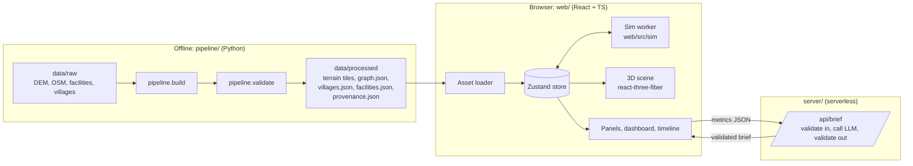

# ARCHITECTURE — Setu

Status: draft v0.1. Pairs with `docs/SPEC.md`. Significant changes are logged in `docs/DECISIONS.md`.

## 1. Principles

1. **Heavy GIS happens offline.** The browser never parses raw DEMs or OSM extracts. It loads small, validated, static artifacts.
2. **The simulation is a pure function.** `run(graph, scenario, seed) -> result`. No rendering, no DOM, no wall clock, no `Math.random`.
3. **Rendering reads results; it does not decide them.** The 3D layer visualises output from the sim. It never computes metrics.
4. **The LLM narrates; it does not compute.** All numbers originate in the sim core.
5. **Everything shown is traceable** to a dataset, a computed value, or a labelled assumption.

## 2. System overview



## 3. Repository layout

```
Setu/
  CLAUDE.md
  README.md
  docs/                 SPEC, ARCHITECTURE, RULES, DATA, DECISIONS, ROADMAP
  data/
    raw/                immutable inputs (gitignored; see DATA.md)
    processed/          pipeline outputs consumed by the web app
  pipeline/             Python: build and validate processed artifacts
  server/               serverless function(s): LLM brief proxy
  web/
    public/             static assets served as-is
    src/
      sim/              PURE TS: graph, routing, events, agents, metrics, assumptions
      render/           react-three-fiber scene: terrain, roads, villages, agents
      ui/               panels, dashboard, timeline, controls
      state/            Zustand slices (scene, scenario, run, ui)
      lib/              shared helpers (units, geo, i18n, schema types)
  .github/
```

Import rules (enforced by lint):

- `sim/` imports from `lib/` only. It must not import `react`, `three`, `@react-three/*`, or reference `window`/`document`.
- `render/` and `ui/` import from `state/` and `lib/`, never directly from `sim/` internals. They get results via the store.
- `state/` is the only module that talks to the worker, and the only one that imports `sim/`. It re-exports what the UI and the 3D layer need through `state/sim-api.ts`, so everything else imports the simulation through that one gateway.

## 4. Data artifacts (produced by `pipeline/`)

Schemas are defined in `docs/DATA.md`. Summary:

| Artifact | Purpose |
|---|---|
| terrain tiles | heightmap for the mesh, plus bounds and vertical scale metadata |
| `graph.json` | road network: nodes (junctions, village access points, facility access points) and edges (length, class, elevation profile, geometry) |
| `villages.json` | name, location, population (with estimate method), access node id |
| `facilities.json` | name, tier, location, access node id |
| `provenance.json` | per-dataset source, licence, retrieval date, notes on gaps and manual patches |

The validator fails the build if: the graph is disconnected in unexpected ways, a village or facility has no access node, coordinates fall outside the corridor bounds, units are missing, or required provenance fields are empty.

## 5. Coordinate systems and units

- Stored and exchanged geometry: WGS84 (EPSG:4326), longitude and latitude, elevation in metres.
- Rendering space (ADR-009): a local flat-earth frame in metres centred on the corridor, built in `lib/geo.ts` from WGS84 degree lengths at the corridor's central latitude. East-west scale error across the corridor is about 0.2%, which is fine for display. Rendering coordinates are never used for measurement.
- Simulation distances: geodesic (haversine) segment lengths computed in the pipeline when the routing graph is built (M3). The Rudraprayag corridor sits in UTM zone 44N (EPSG:32644) if a projected CRS is later needed. The zone is configured per area, not hard-coded.
- Conversion from WGS84 to the rendering frame happens in `lib/geo` only.
- Units in code are SI, with suffixes in names: `length_m`, `time_s`, `speed_kmh` where non-SI is unavoidable. Time in the sim is seconds from event start.

## 6. Simulation model (`web/src/sim`)

### 6.1 Network

- Graph `G = (V, E)`. Nodes: junctions, village access points, facility access points. Edges: road segments with `length_m`, `road_class`, `free_speed_kmh`, and an elevation profile.
- Travel time on an edge: `length_m / speed`, where speed starts from the road-class free speed and is reduced by a slope factor. Free speeds and slope factors live in `assumptions.ts` with their basis. They are assumptions until validated.

### 6.2 Events

An event is a list of timed edge mutations: `{ edge_id, t_close_s, t_reopen_s | null, speed_factor }`. Scenario definitions (`sim/scenarios/*`) translate user input (target, severity) into mutations. Clearance times come from an assumptions table keyed by severity and road class.

### 6.3 Routing and metrics

- Access times for all villages are computed with a multi-source Dijkstra from all open facilities over the reversed graph, so one pass answers every village.
- The sim recomputes access times at each topology change (an edge closing or reopening), not every frame. Results form a time series of metric snapshots.
- Metric definitions are in `docs/SPEC.md` section 6. The implementation lives in `sim/metrics.ts` and must match them exactly.

### 6.4 Agents

- Agents are a visual and behavioural layer on top of the network model, not the source of metrics.
- Population is represented by a bounded number of agents per village (scaled, for example one agent per N people, capped globally at about 300).
- Each scenario defines a small finite-state machine per agent role: resident, ambulance. States such as `idle`, `moving_to_clinic`, `moving_to_safe_point`, `waiting_at_block`, `rerouting`, `arrived`.
- Movement follows shortest paths on the surviving graph and is re-planned on topology change.
- Agent decisions use a seeded PRNG (`sim/rng.ts`, for example mulberry32), only for tie-breaking and timing jitter. No randomness decides outcomes the dashboard reports.

### 6.5 Determinism

`run(inputs, seed)` is reproducible. Results are serialisable as a "run record" (inputs, seed, version) so a scenario can be replayed or exported.

## 7. Worker protocol

**Status (ADR-010):** in M3 and M4 the simulation runs on the main thread, because one scenario run takes milliseconds on this graph. The protocol below becomes real in M5 when moving agents arrive and per-frame work could block the UI. `sim/` is already free of DOM and rendering imports, so moving it into a worker is a wrapper, not a rewrite.

The sim runs in a Web Worker so the UI never blocks.

| Message | Direction | Payload |
|---|---|---|
| `init` | main to worker | graph, villages, facilities (structured clone, once) |
| `run` | main to worker | scenario params, seed, run id |
| `frame` | worker to main | agent positions as a transferable typed array, sim time, run id |
| `metrics` | worker to main | metric snapshots (time series), run id |
| `done` | worker to main | run record, run id |
| `error` | worker to main | message, run id |

A new `run` cancels the previous one (match on run id). Agent positions are sent as transferable `Float32Array`s to avoid copying.

## 8. Rendering (`web/src/render`)

- **Terrain:** mesh from heightmap tiles, with a vertical exaggeration parameter and chunked loading. Shading is restrained: hillshade-style lighting, muted palette, no decorative textures.
- **Roads:** line geometry draped on the terrain by sampling heights. Closed segments change style and animate once on closure.
- **Villages and facilities:** instanced markers with labels via screen-space projection, decluttered at distance.
- **Agents:** instanced meshes, updated from the latest `frame` buffer at a fixed rate.
- **Markers:** facility pins, village dots and scenario markers keep a constant size on screen at any zoom (sized by world units per pixel at the orbit point), so they stay small and never swell into each other. Minor facilities appear only when the camera is close. Markers ease in over a few hundred milliseconds when a scenario runs, and not at all when the person prefers reduced motion.
- **Ground block:** the terrain sits on a solid block. Four walls follow the terrain's edge profile down to a flat base, drawn with a layered soil-and-stone texture whose bands are measured as depth below the surface. The base and walls are decoration; nothing measures against them.
- **Camera:** orbit controls with constrained pitch, zoom limits, and a reset control.
- **Picking:** raycast for terrain points; for road selection, snap to the nearest edge within a pixel tolerance using a spatial index built from the graph.
- **Budget:** see SPEC section 10. Measure on the reference machine before adding any visual effect.

## 9. State (`web/src/state`)

Zustand slices:

- `scene`: loaded assets, camera, layer visibility
- `scenario`: selected scenario, params, target
- `run`: run id, status, metric time series, current sim time, playback state
- `ui`: panels, before/after toggle, language

Rules: the store is the only owner of worker communication. Derived values (for example "current metric snapshot at time t") are selectors, not stored copies.

## 10. LLM brief service

- One endpoint: `POST /api/brief`. The logic is a single framework-agnostic function, `handleBrief`, in `web/src/brief/handler.ts`. Two thin adapters call it: a Vite dev-server route in `web/vite.config.ts` (settings from `web/.env.local`) and a Netlify function in `server/brief.mts` (settings from the site's environment variables). The handler picks the provider: a local Ollama model by default, or the Claude API when a key is set or `BRIEF_PROVIDER=anthropic`.
- Steps: limit the request size, parse and clean the request (`parseBriefInput`), apply a small per-client rate limit, call the Messages API with a fixed system prompt, extract the JSON object, validate it (`validateBrief`: schema, metric references, and the number check against the input), retry once with the exact problems listed, then return the result or a clear error status.
- A Claude API key, if used, lives in server environment variables only. It is never sent to the browser and never included in any response. With Ollama there is no key and the request never leaves the computer.
- The browser (`web/src/brief/client.ts`) validates the answer again, and falls back to the rule-based template (`template.ts`) whenever the service is unavailable or the answer is rejected, labelling it as such.
- Contract: `docs/SPEC.md` section 8.

## 11. Testing strategy

- **Sim core (Vitest):** small fixture graphs with known answers. Properties to test: closing an edge never decreases any access time; reopening restores the original access times; the same seed gives identical run records; isolated villages are exactly those unreachable from all open facilities.
- **Metric golden tests:** for the real corridor, snapshot key metrics for fixed scenarios and seeds, so regressions are visible in review.
- **Pipeline validators:** run in CI against `data/processed`.
- **UI smoke test:** load, trigger S1, see a dashboard. Add only if time allows.

## 12. Build and deploy

- Static web build plus one serverless function, hosted on Netlify (Netlify Functions for `/api/brief`).
- Large processed assets: keep each file under GitHub's 100 MB limit, and prefer tiles that load progressively. If assets grow, use Git LFS or host them from the deploy rather than committing.
- Environment variables are documented in `README.md`; no secrets in the repo.

## 13. Known risks

| Risk | Mitigation |
|---|---|
| Thin or missing hill road data in OSM | Hand-patch the corridor, record each patch in `provenance.json`, show it in the provenance panel |
| Village population not available at usable resolution | Estimate from building counts with a stated persons-per-household assumption |
| Terrain mesh too heavy for mid-range laptops | Chunked tiles, lower resolution beyond the focus area, measure early |
| LLM output invents figures | Number check against the input (server and browser), schema validation, one correction retry, labelled template fallback |
| Scope creep into extra scenarios | Stretch scenarios stay behind the v1 acceptance criteria |
